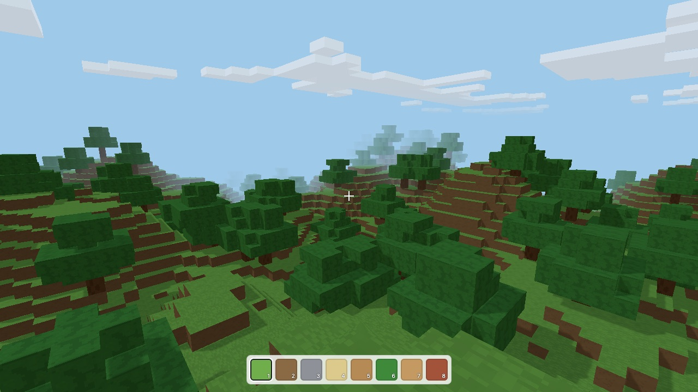
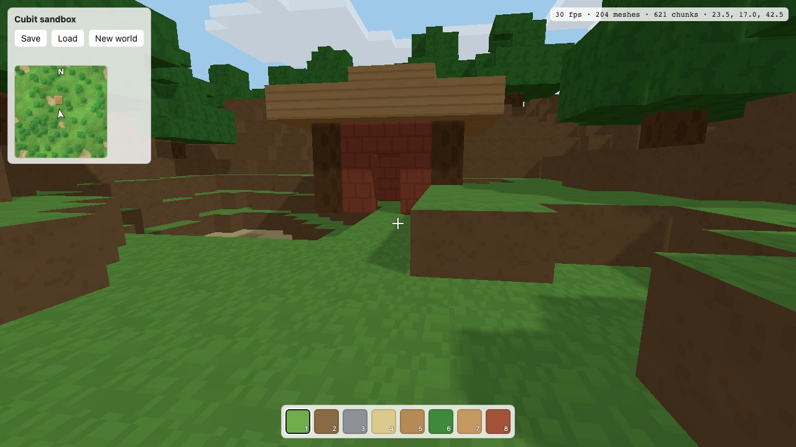
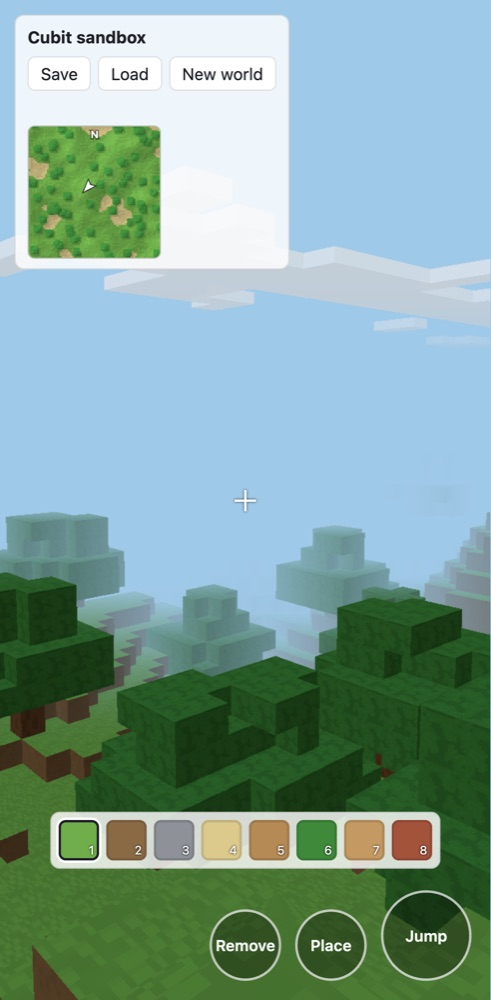

# Cubit

A voxel game engine for the browser, written in TypeScript.

Game state in Cubit is plain, serializable data, and every change to the world
goes through a command that an authoritative simulation validates. A
single-player game runs that whole loop inside one browser tab, with every
message passed through JSON the way a network would carry it. The same game can
later sit behind a server without rewriting how its state works.



<p>
  
  
</p>

The screenshots are from the sandbox in `examples/sandbox`, at its default seed.

## What it does

- Chunked block worlds with a fixed-tick simulation, walking physics and
  collision, raycasting and reach checks.
- A host and client split even in single player. The client draws only what
  the host has sent it, so nothing in a game can quietly depend on shared memory.
- Saves as snapshots that store only the chunks a player changed, in JSON or a
  compact binary form. Chunks serialize with a palette of block names, so a save
  survives a game reordering its blocks.
- Game rules as plain functions: systems that run every tick, named actions a
  player can take, and a check that can refuse a player's block edits.
- A three.js renderer with face-culled chunk meshes, textures painted in code
  (no image files), optional sun lighting with soft shadows, blocky clouds,
  see-through liquids, voxel models for entities, and a highlight on the aimed
  block.
- Keyboard, mouse and touch input. Phones get on-screen controls, and browsers
  that refuse pointer lock fall back to drag-to-look.
- A top-down minimap drawn from the client's copy of the world.
- Hand-built levels as JSON regions alongside generated terrain, patrol routes,
  line-of-sight checks and a seeded random generator.

Cubit is content-neutral. A game brings its own blocks, world generator and
rules; the engine ships no game content and no textures from elsewhere.

## Status

Pre-1.0. The API still changes between minor versions, and each release says
what changed in its commit message. Single player is complete and used by a
game in development. Multiplayer is designed for but not built: the server,
interest management, client-side prediction, delta updates and chunk unloading
are listed in [docs/architecture.md](docs/architecture.md#multiplayer-what-is-done-and-what-is-not).
Performance has been checked on desktop browsers, not yet on a low-end phone.

## Try the sandbox

You need Node.js 20.19 or newer and pnpm 10.

```bash
pnpm install
pnpm dev
```

Then open http://127.0.0.1:5173. On a computer, click to play: WASD moves,
Space jumps, Shift runs, the mouse looks, left click removes a block, right
click places one, and 1 to 8 pick a block. On a phone, drag on the left to move
and on the right to look. Save and Load keep the world in the browser, and
`?seed=` in the URL picks another world.

## Packages

| Package | Runs in | What it holds |
|---|---|---|
| [`@cubit/core`](packages/core) | browser or server | blocks, chunks, entities, commands, physics, the simulation, the host and client, serialization, meshing, texture styles |
| [`@cubit/three`](packages/three) | browser | a three.js renderer for a client's world |
| [`@cubit/input`](packages/input) | browser | keyboard, mouse and touch, turned into abstract actions |
| [`@cubit/minimap`](packages/minimap) | browser | a top-down map on a 2D canvas |

`@cubit/core` never imports three.js and never touches a browser global, and a
test fails if it does. That is what will let the same simulation run on a
server.

## Using Cubit in a game

The packages are published to GitHub Packages as `@mmncit/cubit-core`,
`@mmncit/cubit-three`, `@mmncit/cubit-input` and `@mmncit/cubit-minimap`.
GitHub's npm registry asks for a token even for public packages, so create a
classic personal access token with the `read:packages` scope and point the
`@mmncit` scope at GitHub in your project's `.npmrc`:

```ini
@mmncit:registry=https://npm.pkg.github.com
//npm.pkg.github.com/:_authToken=${NPM_TOKEN}
```

Then install them under their `@cubit/*` names, which is how the code imports
them:

```bash
NPM_TOKEN=<your token> pnpm add @cubit/core@npm:@mmncit/cubit-core@^0.10.0 \
  @cubit/three@npm:@mmncit/cubit-three@^0.10.0 \
  @cubit/input@npm:@mmncit/cubit-input@^0.10.0
```

The packages ship TypeScript source rather than built JavaScript, and your
bundler compiles them. Use a bundler that handles TypeScript (Vite does) and a
tsconfig close to [tsconfig.base.json](tsconfig.base.json): `strict`,
`moduleResolution: "bundler"` and `verbatimModuleSyntax`.

A minimal game: a generated world you can walk around and dig.

```ts
import { BlockRegistry, ClientWorld, createTerrainGenerator, EYE_HEIGHT_RATIO, LocalHost, raycast, Simulation, viewDirection, type Vec3 } from "@cubit/core";
import { InputManager } from "@cubit/input";
import { VoxelRenderer } from "@cubit/three";

const registry = new BlockRegistry();
registry.define({ name: "grass", colors: { top: 0x6fae4a, side: 0x8a6a45, bottom: 0x7b5b3a }, texture: { top: "grass", side: "soil" } });
registry.define({ name: "dirt", color: 0x8a6a45, texture: "soil" });
registry.define({ name: "stone", color: 0x8d9197, texture: "stone" });

const generator = createTerrainGenerator({ surface: "grass", subsurface: "dirt", deep: "stone" });
const sim = new Simulation({ registry, generator, seed: 1, loadRadius: 5 });
const host = new LocalHost(sim);
const client = new ClientWorld(registry);

const canvas = document.querySelector("canvas")!;
const renderer = new VoxelRenderer({ canvas, registry, renderDistance: 4, lighting: true });
const input = new InputManager(canvas);
const connection = host.connect({ onMessage: (message) => renderer.applyChanges(client.apply(message)) });
renderer.resize(innerWidth, innerHeight);

let yaw = 0, pitch = 0, last = performance.now();
requestAnimationFrame(function frame(now) {
  const intent = input.consume();
  yaw -= intent.lookX;
  pitch = Math.max(-1.55, Math.min(1.55, pitch - intent.lookY));
  connection.send({ type: "command", command: { type: "input", forward: intent.forward, strafe: intent.strafe, jump: intent.jump, sprint: intent.sprint, yaw, pitch } });

  const alpha = host.advance(Math.min(0.1, (now - last) / 1000));
  last = now;
  const player = client.player();
  if (player) {
    const feet = client.interpolatedPosition(player.id, alpha)!;
    const eye: Vec3 = [feet[0], feet[1] + player.size[1] * EYE_HEIGHT_RATIO, feet[2]];
    renderer.setView(eye, yaw, pitch);
    const hit = raycast(client, eye, viewDirection(yaw, pitch), 6);
    renderer.setHighlight(hit?.position ?? null);
    if (hit && intent.primary) connection.send({ type: "command", command: { type: "setBlock", position: hit.position, block: "air" } });
  }
  renderer.render(client);
  requestAnimationFrame(frame);
});
```

[examples/sandbox/src/main.ts](examples/sandbox/src/main.ts) is the same game
with block placing, saving, a minimap and touch controls.

### Game rules

A game adds its rules to the simulation. They see only simulation state, so
they will run unchanged on a server.

```ts
import type { GameAction, GameSystem } from "@cubit/core";

// Runs every tick, after commands and before physics.
const fallDamage: GameSystem = ({ sim, landings }) => {
  for (const [id, speed] of landings) {
    const entity = sim.state.entities.get(id);
    if (entity && speed > 20) entity.data.hurt = true;
  }
};

// A player's { type: "act", action: "ring" } command. Return a reason to refuse it.
const ring: GameAction = ({ actor, tick }) => {
  if (actor.data.rang) return "already rung";
  actor.data.rang = tick;
  return null;
};

const sim = new Simulation({
  registry, generator, seed: 1,
  systems: [fallDamage],
  actions: { ring },
  // Refuse a player's block edits anywhere the game says the world is fixed.
  canEdit: ({ position }) => (position[1] < 2 ? "too deep" : null),
});
```

Game-specific entity fields live in `entity.data` and must be JSON. Block ids
are local to one registry and never leave the process; saves and messages name
blocks instead.

## Documentation

- [docs/architecture.md](docs/architecture.md): how the pieces fit together,
  the rules that keep multiplayer possible, and what is still to do.
- [CONTRIBUTING.md](CONTRIBUTING.md): building, testing and sending changes.
- [SECURITY.md](SECURITY.md): reporting a vulnerability.

## Development

```bash
pnpm dev          # the sandbox at http://127.0.0.1:5173
pnpm test         # vitest, in node
pnpm typecheck    # every package; core without the DOM library
pnpm build        # production build of the sandbox
```

## Licence

[MIT](LICENSE).
